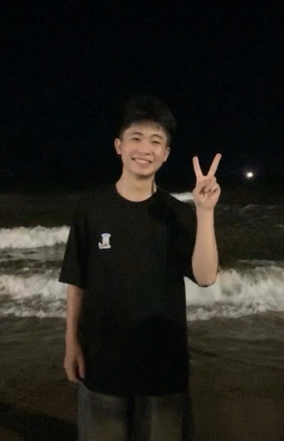

# Locket-60s AI — Python 3.14 + OpenAI



Giữ dữ liệu của Hoàng: cấu hình 60 giây, 219 caption, bộ lọc, ảnh/lời giới thiệu Zalo và YouTube. Phần AI gọi OpenAI Images API qua backend Python trên máy tính của bạn, rồi trả URL ảnh kết quả cho script Locket.

**Trạng thái:** đã kiểm thử tự động bằng dữ liệu giả lập trên Python 3.14.5. Chưa kiểm tra bằng API key thật hoặc trên iPhone. Module cần backend đang chạy, HTTPS và tài khoản OpenAI API có quyền sử dụng model; cài module riêng lẻ chưa tạo được ảnh.

## Chạy trên Windows

1. Thu hồi khóa API đã từng gửi vào chat hoặc công khai; tạo khóa mới tại [OpenAI API keys](https://platform.openai.com/api-keys). Nhập khóa mới trực tiếp trên máy, không gửi lại vào chat.
2. Mở `Start-Locket-Backend.cmd` trong thư mục này. Bộ khởi chạy ưu tiên Python 3.14 ở `%LOCALAPPDATA%\Python\pythoncore-3.14-64\python.exe`, sau đó thử `py -3.14`. Không cần cài thư viện pip.
3. Trên Windows, cửa sổ **Locket AI - Nhap khoa OpenAI** sẽ mở riêng. Bấm vào ô nhập, dùng **Ctrl+V** dán nguyên khóa vừa tạo rồi bấm **OK**. Khóa được che bằng dấu `*`; **Cancel** hoặc nút X hủy khởi chạy. Không dán giá trị bị che/rút gọn trong danh sách khóa. Nếu nhập trống hoặc sai định dạng, cửa sổ mở lại với hướng dẫn, tối đa ba lần. Bộ khởi chạy tạo một mã kết nối backend và hiện mã đó một lần trong cửa sổ CMD của bạn. Giữ mã này để nhập vào Shadowrocket.
4. Bộ khởi chạy dùng `cloudflared` đã cài trên máy để mở HTTPS tạm thời tới `127.0.0.1:8787`. Sao chép dòng `Shadowrocket backend URL: https://…trycloudflare.com`.
5. Giữ cửa sổ và máy tính hoạt động. `Ctrl+C` dừng backend cùng tiến trình tunnel do nó tạo. Mỗi lần mở lại có thể đổi URL và mã kết nối; cập nhật lại trên điện thoại.

Khóa API và mã kết nối chỉ nằm trong bộ nhớ của phiên chạy, không được bộ khởi chạy ghi ra tệp. `cloudflared` không được truyền các biến môi trường chứa hai bí mật này. Khóa OpenAI chỉ gửi tới OpenAI; điện thoại chỉ giữ mã kết nối backend. API có thể phát sinh phí theo tài khoản OpenAI của bạn.

Có thể tạo `.env` từ `.env.example` để đổi **thiết lập công khai** như model, thư mục ảnh hoặc giới hạn. Bộ khởi chạy từ chối các bí mật có giá trị trong `.env`; nhập qua lời nhắc ẩn hoặc biến môi trường của tiến trình. Không nhập API key vào module hoặc trang kết nối Shadowrocket.

Nếu không dùng tunnel tạm, chạy `run_backend.py` bằng Python 3.14 và đặt `PUBLIC_BASE_URL` thành HTTPS origin của reverse proxy riêng. Mặc định backend chỉ nghe `127.0.0.1:8787`. `--no-prompt` dùng cấu hình môi trường sẵn có và không hỏi hoặc tự tạo bí mật. Thiếu key/token/HTTPS origin thì `/health` trả `configured:false`, API chỉnh ảnh trả 503.

Ô nhập riêng dùng Tkinter đi kèm bản Python trên Windows. Nếu máy khác thiếu Tcl/Tk, chương trình báo lỗi và dừng; không tự chuyển sang nhập hiện khóa. Chỉ dùng `--console-key` khi bạn muốn nhập ẩn trong terminal. Lỗi CMD chỉ hiện một dấu `*` rồi báo ký tự điều khiển khi nhấn Ctrl+V được tránh bằng cửa sổ nhập riêng.

## Kết nối Shadowrocket

Thêm hoặc làm mới [module Locket 60s AI + YouTube](https://raw.githubusercontent.com/nghhoag05-art/Locket-60s-AI/main/module/locket-60s-ai-youtube.module). Chỉ bật một module Locket để tránh trùng quy tắc; bật HTTPS Decryption với chứng chỉ CA đang dùng.

Trên điện thoại đang chạy Shadowrocket, mở:

`http://locket-ai-setup.invalid/`

Đây là trang được script trả trực tiếp trên thiết bị. Nhập URL HTTPS và mã kết nối hiện trong cửa sổ backend, rồi lưu. Hai giá trị được lưu trong Shadowrocket; có nút xóa kết nối. Không dùng token đăng nhập Locket hoặc API key OpenAI làm mã kết nối.

Khi nhận diện được yêu cầu tạo filter, script chỉ gửi `{imageUrl, prompt}` và mã kết nối riêng tới backend. Backend tải ảnh, gửi ảnh cùng prompt tới OpenAI và lưu ảnh đầu ra. Script chỉ trả thành công khi nhận URL kết quả hợp lệ; thiếu cấu hình hoặc lỗi thì giữ yêu cầu gốc cho Locket xử lý.

## Cấu hình backend

| Biến | Mặc định / ý nghĩa |
| --- | --- |
| `OPENAI_API_KEY` | Bí mật, chỉ nhập ẩn hoặc đặt trong môi trường tiến trình backend. |
| `BACKEND_ACCESS_TOKEN` | Bí mật riêng cho điện thoại; bộ khởi chạy tự tạo trong phiên tương tác nếu chưa có. |
| `PUBLIC_BASE_URL` | HTTPS origin, không kèm port/path/query; tự đặt khi dùng `--tunnel`. |
| `OPENAI_IMAGE_MODEL` | `gpt-image-2.5-flare`; tài khoản cần có quyền và quota sử dụng. |
| `DATA_DIR` | `data/generated` trong thư mục dự án khi dùng bộ khởi chạy. Có thể đặt sang ổ D: hoặc thư mục không đồng bộ. |
| `IMAGE_TTL_SECONDS` | `900`: ảnh kết quả tồn tại tối đa 15 phút. |
| `RATE_LIMIT_PER_MINUTE` / `MAX_CONCURRENT` | `3` yêu cầu/phút và `1` yêu cầu đồng thời. |

URL ảnh kết quả có tên ngẫu nhiên; người có link có thể xem ảnh đến khi hết hạn. Ảnh hết hạn bị từ chối ngay khi đọc, được dọn định kỳ khi backend chạy. Tệp ảnh, `.env` và cache Python được bỏ qua bởi Git.

Backend chỉ tải PNG/JPEG/WebP qua HTTPS từ các host ảnh mặc định `firebasestorage.googleapis.com`, `storage.googleapis.com`, `cdn.locketcamera.com`. Không theo redirect hoặc truy cập IP nội bộ. Chỉ bổ sung host ảnh tin cậy đã quan sát vào `INPUT_IMAGE_HOSTS`.

Repo có Dockerfile Python 3.14; khi tự triển khai cần truyền bí mật qua môi trường và đặt reverse proxy HTTPS. Bộ khởi chạy Windows và Docker là hai cách chạy thay thế nhau.

## Kiểm thử và giới hạn

Chạy bằng Python 3.14 đã cài:

```powershell
& "$env:LOCALAPPDATA\Python\pythoncore-3.14-64\python.exe" -m unittest discover -s test_python -v
```

Kiểm tra JavaScript bằng Node.js 22 trở lên:

```powershell
npm test
```

Các kiểm thử dùng dữ liệu mô phỏng, không gọi OpenAI hay tạo phí. Chúng kiểm tra hợp đồng HTTP, xác thực, lỗi provider, giới hạn, lưu/xóa ảnh, bộ khởi chạy, script và trang kết nối.

Chưa có request/response thực tế thu từ iPhone; schema hoặc cách Locket nhận ảnh có thể khác với mã hiện tại. Client hỗ trợ một số trường URL/prompt và 11 ID filter đã biết; schema chưa biết đi qua nguyên trạng. Ngân sách chờ provider mặc định 32 giây để nằm trong thời gian chờ của script; tác vụ chậm có thể thất bại dù phía provider vẫn tính phí.

Cấu hình quay 60 giây còn phụ thuộc app/server. Gold là dữ liệu mô phỏng; YouTube chưa được thử trên iPhone ở lần sửa này. Không có xác nhận tạo ảnh thành công trong ứng dụng cho đến khi thử với backend, khóa mới và thiết bị thật.

Nguồn: [SOURCES.md](SOURCES.md). Mã kiểm tra: `SHA256SUMS.txt`.

