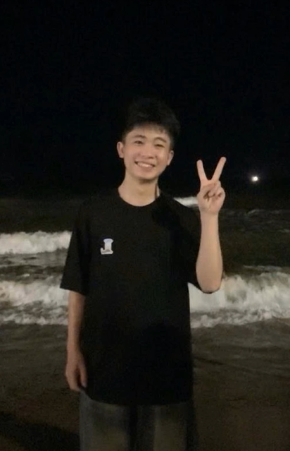

# Locket-60s AI + Photobooth Hoàng



Thêm AI và Photobooth vào module cá nhân đang dùng của Hoàng. Giữ nguyên cấu hình 60 giây, 219 caption, ảnh/lời giới thiệu Zalo và YouTube. Phần AI gọi OpenAI bằng tài khoản riêng của bạn; phần khung/Photobooth được ghép thật bằng Python trên máy bạn.

Danh mục có 83 mục, 10 nhóm và 63 mục chọn nhanh: 56 hiệu ứng AI cùng 27 khung/Photobooth. Script AI, danh mục và ảnh xem trước đều tải từ repo của Hoàng; việc tạo ảnh/ghép khung dùng backend riêng, không chuyển yêu cầu tới Worker anhtu4nn/Hakaiz hoặc dùng mã truy cập module của họ. Nguồn tham khảo vẫn được ghi công trong `SOURCES.md`.

**Trạng thái:** đã kiểm tra bộ ghép ảnh bằng PNG/JPEG/WebP và đọc lại pixel ảnh kết quả, cùng kiểm thử HTTP/client bằng dữ liệu mô phỏng. Chưa gọi OpenAI thật hoặc xác nhận luồng chụp trên iPhone. Module cần backend đang chạy và HTTPS; AI cần tài khoản OpenAI API có quyền dùng model. Cài module riêng lẻ chưa cung cấp máy chủ tạo ảnh.

## Chạy trên Windows

1. Thu hồi khóa API đã từng gửi vào chat hoặc công khai; tạo khóa mới tại [OpenAI API keys](https://platform.openai.com/api-keys). Nhập khóa mới trực tiếp trên máy, không gửi lại vào chat.
2. Mở `Start-Locket-Backend.cmd` trong thư mục này. Bộ khởi chạy ưu tiên Python 3.14 ở `%LOCALAPPDATA%\Python\pythoncore-3.14-64\python.exe`, sau đó thử `py -3.14`. Nó tạo môi trường `.venv` riêng và tự cài Pillow 13.0.0 từ `requirements.txt` nếu cần. Lần đầu chuẩn bị thư viện cần Internet; không thay đổi Python toàn máy.
3. Trên Windows, cửa sổ **Locket AI - Nhap khoa OpenAI** sẽ mở riêng. Bấm vào ô nhập, dùng **Ctrl+V** dán nguyên khóa vừa tạo rồi bấm **OK**. Khóa được che bằng dấu `*`; **Cancel** hoặc nút X hủy khởi chạy. Không dán giá trị bị che/rút gọn trong danh sách khóa. Nếu nhập trống hoặc sai định dạng, cửa sổ mở lại với hướng dẫn, tối đa ba lần. Bộ khởi chạy tạo một mã kết nối backend và hiện mã đó một lần trong cửa sổ CMD của bạn. Giữ mã này để nhập vào Shadowrocket.
4. Bộ khởi chạy dùng `cloudflared` đã cài trên máy để mở HTTPS tạm thời tới `127.0.0.1:8787`. Sao chép dòng `Shadowrocket backend URL: https://…trycloudflare.com`.
5. Giữ cửa sổ và máy tính hoạt động. `Ctrl+C` dừng backend cùng tiến trình tunnel do nó tạo. Mỗi lần mở lại có thể đổi URL và mã kết nối; cập nhật lại trên điện thoại.

Khóa API và mã kết nối chỉ nằm trong bộ nhớ của phiên chạy, không được bộ khởi chạy ghi ra tệp. `cloudflared` không được truyền các biến môi trường chứa hai bí mật này. Khóa OpenAI chỉ gửi tới OpenAI; điện thoại chỉ giữ mã kết nối backend. API có thể phát sinh phí theo tài khoản OpenAI của bạn.

Có thể tạo `.env` từ `.env.example` để đổi **thiết lập công khai** như model, thư mục ảnh hoặc giới hạn. Bộ khởi chạy từ chối các bí mật có giá trị trong `.env`; nhập qua lời nhắc ẩn hoặc biến môi trường của tiến trình. Không nhập API key vào module hoặc trang kết nối Shadowrocket.

Nếu không dùng tunnel tạm, chạy `run_backend.py` bằng Python 3.14 và đặt `PUBLIC_BASE_URL` thành HTTPS origin của reverse proxy riêng. Mặc định backend chỉ nghe `127.0.0.1:8787`. `--no-prompt` dùng cấu hình môi trường sẵn có và không hỏi hoặc tự tạo bí mật. Thiếu key/token/HTTPS origin thì `/health` trả `configured:false`, API chỉnh ảnh trả 503.

Ô nhập riêng dùng Tkinter đi kèm bản Python trên Windows. Nếu máy khác thiếu Tcl/Tk, chương trình báo lỗi và dừng; không tự chuyển sang nhập hiện khóa. Chỉ dùng `--console-key` khi bạn muốn nhập ẩn trong terminal. Lỗi CMD chỉ hiện một dấu `*` rồi báo ký tự điều khiển khi nhấn Ctrl+V được tránh bằng cửa sổ nhập riêng.

## Kết nối Shadowrocket

Thêm hoặc làm mới [module cá nhân Locket 60s AI + YouTube + Photobooth](https://raw.githubusercontent.com/nghhoag05-art/Locket-60s-AI/refs/heads/main/module/locket-60s-ai-youtube.module). Đây vẫn là URL module cũ. Chỉ bật một module Locket để tránh trùng quy tắc; bật HTTPS Decryption với chứng chỉ CA đang dùng.

Trên điện thoại đang chạy Shadowrocket, mở:

`http://locket-ai-setup.invalid/`

Đây là trang được script trả trực tiếp trên thiết bị. Nhập URL HTTPS và mã kết nối hiện trong cửa sổ backend, rồi lưu. Hai giá trị được lưu trong Shadowrocket; có nút xóa kết nối. Không dùng token đăng nhập Locket hoặc API key OpenAI làm mã kết nối.

Sau khi cập nhật module, tải lại các script, đóng hẳn rồi mở lại Locket. Hook Firebase bỏ các header kiểm tra cache; response danh mục được đánh dấu `UPDATE`. Trang kết nối sẽ hiện **Đã áp dụng AI và Photobooth Hoàng gồm 83 mục** sau khi script cấu hình mới chạy trên thiết bị. Nếu vẫn chỉ thấy danh sách cũ, kiểm tra trạng thái này trước khi thử nhập khóa lại.

Trang kết nối cũng hiện lần xử lý gần nhất bằng thông báo cố định (thiếu cấu hình, thiếu trường ảnh, hiệu ứng chưa hỗ trợ, lỗi backend hoặc có ảnh mới). Phần chẩn đoán chỉ lưu mã bước, mã trạng thái và thời điểm; không lưu prompt, URL ảnh, token hay UID.

Khi nhận diện được yêu cầu AI, script chỉ gửi `{imageUrl, prompt}` và mã kết nối riêng tới `/v1/images/edit`. Backend tải ảnh, gửi ảnh cùng prompt tới OpenAI và lưu ảnh đầu ra. Với khung/Photobooth, script gửi `{presetId, imageUrl}` hoặc `{presetId, imageUrls}` tới `/v1/images/compose`; backend ghép với PNG trong repo, không gọi OpenAI. Không chuyển token Locket hoặc toàn bộ request của app. Chỉ trả thành công khi nhận URL ảnh mới hợp lệ; thiếu cấu hình hoặc lỗi thì giữ yêu cầu gốc cho Locket xử lý.

## Photobooth và khung ảnh

- 18 khung một ảnh và 9 bố cục Photobooth bốn ô được xử lý trên backend của Hoàng.
- Khi nhận bốn ảnh riêng, bộ ghép giữ thứ tự và đặt mỗi ảnh vào một ô. Khi chỉ nhận một ảnh, bộ ghép dùng lại ảnh đó trong bốn ô; trạng thái ghi rõ đây là một nguồn ảnh, không báo đã chụp bốn lần.
- Các trường `ptbFrameId` và `captureCountHint` được ghép theo cấu trúc bản tham khảo. Chúng chỉ là gợi ý cho Locket; chưa xác nhận phiên bản app trên iPhone sẽ chụp/gửi bốn ảnh riêng. Các trường mảng `imageUrls`/`image_urls`/`inputUrls`/`input_urls` là hợp đồng bridge hỗ trợ thêm, chưa có chứng cứ chúng được Locket phát ra.
- Khung được vẽ thành PNG trong dự án với vùng ảnh trong suốt và chữ Hoàng. Một số ảnh nguồn đã bị gỡ; công cụ chuẩn bị tài nguyên thay bằng biểu tượng riêng, không phụ thuộc ảnh xem trước bên ngoài khi chạy.
- Input được xoay theo EXIF, cắt vừa ô, ghép alpha, rồi xuất PNG mới không mang EXIF/GPS. Chỉ chọn preset có sẵn; client không được yêu cầu backend tải một overlay URL bất kỳ.

## Cấu hình backend

| Biến | Mặc định / ý nghĩa |
| --- | --- |
| `OPENAI_API_KEY` | Bí mật, chỉ nhập ẩn hoặc đặt trong môi trường tiến trình backend. |
| `BACKEND_ACCESS_TOKEN` | Bí mật riêng cho điện thoại; bộ khởi chạy tự tạo trong phiên tương tác nếu chưa có. |
| `PUBLIC_BASE_URL` | HTTPS origin, không kèm port/path/query; tự đặt khi dùng `--tunnel`. |
| `OPENAI_IMAGE_MODEL` | `gpt-image-2.5-flare`; tài khoản cần có quyền và quota sử dụng. |
| `DATA_DIR` | `data/generated` trong thư mục dự án khi dùng bộ khởi chạy. Có thể đặt sang ổ D: hoặc thư mục không đồng bộ. |
| `IMAGE_TTL_SECONDS` | `900`: ảnh kết quả tồn tại tối đa 15 phút. |
| `RATE_LIMIT_PER_MINUTE` / `MAX_CONCURRENT` | `3` yêu cầu/phút và `1` yêu cầu đồng thời. |

URL ảnh kết quả có tên ngẫu nhiên; người có link có thể xem ảnh đến khi hết hạn. Ảnh hết hạn bị từ chối ngay khi đọc, được dọn định kỳ khi backend chạy. Tệp ảnh, `.env` và cache Python được bỏ qua bởi Git.

Backend chỉ tải PNG/JPEG/WebP qua HTTPS từ các host ảnh mặc định `firebasestorage.googleapis.com`, `storage.googleapis.com`, `cdn.locketcamera.com`. Không theo redirect hoặc truy cập IP nội bộ. Chỉ bổ sung host ảnh tin cậy đã quan sát vào `INPUT_IMAGE_HOSTS`.

Repo có Dockerfile Python 3.14; khi tự triển khai cần truyền bí mật qua môi trường và đặt reverse proxy HTTPS. Bộ khởi chạy Windows và Docker là hai cách chạy thay thế nhau.

## Kiểm thử và giới hạn

Chạy bằng Python 3.14 đã cài:

```powershell
& ".\.venv\Scripts\python.exe" -B -m unittest discover -s test_python -v
```

Sau khi bộ khởi chạy chuẩn bị `.venv`, kiểm tra Python bằng `.\.venv\Scripts\python.exe -B -m unittest discover -s test_python`. Kiểm tra JavaScript bằng Node.js 22 trở lên:

```powershell
npm test
```

Các kiểm thử dùng dữ liệu mô phỏng, không gọi OpenAI hay tạo phí. Chúng kiểm tra hợp đồng HTTP, xác thực, lỗi provider, giới hạn, lưu/xóa ảnh, bộ khởi chạy, script và trang kết nối.

Client hỗ trợ toàn bộ 35 ID hiệu ứng gốc cùng 56 hiệu ứng và 27 preset ghép khung của danh mục cá nhân. Các URL tài nguyên đang dùng đều trỏ tới repo của Hoàng. Không trả ảnh gốc rồi báo đã tạo ảnh AI. `tools/prepare_owned_catalog.py --download` là công cụ chuẩn bị lại tài nguyên công khai, không chạy trong backend; không nhận ảnh hoặc bí mật cá nhân.

Chưa có request/response thực tế thu từ iPhone; schema hoặc cách Locket nhận ảnh có thể khác với mã hiện tại. Schema chưa biết đi qua nguyên trạng. Kiểm thử danh mục và client không xác nhận nút đã bấm được trên mọi phiên bản Locket; cần thử lại trên thiết bị sau khi tải danh mục mới. Ngân sách chờ provider mặc định 32 giây để nằm trong thời gian chờ của script; tác vụ chậm có thể thất bại dù phía provider vẫn tính phí.

Cấu hình quay 60 giây còn phụ thuộc app/server. Gold là dữ liệu mô phỏng; YouTube chưa được thử trên iPhone ở lần sửa này. Không có xác nhận tạo ảnh thành công trong ứng dụng cho đến khi thử với backend, khóa mới và thiết bị thật.

Nguồn: [SOURCES.md](SOURCES.md). Mã kiểm tra: `SHA256SUMS.txt`.

